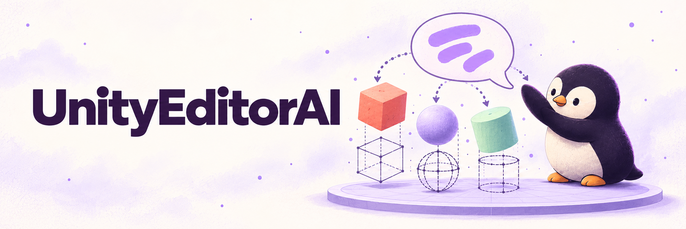

# UnityEditorAI

<picture>
  <source media="(prefers-color-scheme: dark)" srcset="docs/images/unityeditorai-banner-dark.png">
  <source media="(prefers-color-scheme: light)" srcset="docs/images/unityeditorai-banner-light.png">
  
</picture>

<sub>AI-generated concept illustration, not an editor screenshot. <a href="docs/images/ASSETS.md">Asset provenance</a>.</sub>

**From a sentence to a scene — an experiment inside the Unity Editor.**

UnityEditorAI explores how natural language can help Unity developers prototype objects, write C# scripts, and reuse prompts without leaving the editor. It was developed as a Bachelor's thesis in Human-Technology Interaction at Hochschule Ruhr West, in cooperation with Capgemini Germany.


> **Research prototype · Unity 2022.3 LTS target · OpenAI API required**<br>
> This is the thesis-era implementation, with historical model identifiers and an experimental code-execution workflow. Current API compatibility and a fresh Unity import have not been verified. See [limitations](#limitations-and-safe-experimentation) before running it.

[Explore the tools](#six-tools-one-editor-window) · [Setup](#setup-in-a-disposable-unity-project) · [Screenshots](#a-prompt-made-visible) · [Rights and credits](#rights-and-credits)

## Six tools, one editor window

Open **Window → AI Tabs** to switch between:

| Tab | What the implementation does |
| --- | --- |
| **AI Assistant** | Chat with the configured model; copy, save, and load conversations. |
| **AI Script** | Generate or revise C# from prompts, inspect the response, and create a script file. |
| **AI Object Generator** | Generate C# for scene operations, then trigger that code in the editor. |
| **Prompt Manager** | Inspect built-in prompts and add, edit, save, or load custom prompts. |
| **Color Extruder** | Extract pixel colors from a texture, export color data, and request color-generation code. |
| **AI Settings** | Configure the API key, model, output paths, conversation context, temperature, and timeout. |

The project is useful to developers and researchers studying prompt-driven editor tools. It exposes the generated code and the surrounding workflow rather than promising reliable one-click scene production.

## A prompt made visible


The original README pairs this scene with the prompt:

> Generate the floor and the walls of a light red room with a width of 40. Place 50 purple spheres and 50 green cubes inside, that have a rigidbody attached to them.

This is an existing project example, not a guarantee that a new request will reproduce the scene or object counts.

<details>
<summary>See the script, object, and prompt interfaces</summary>

### AI Script


### AI Object Generator


### Prompt Manager


</details>

All images above are retained from this repository's existing `docs/images/` documentation. They show the earlier project UI and examples; no new screenshots or AI illustrations were generated for this README. Separate permission for redistribution of these assets has not been established.

## Setup in a disposable Unity project

**Prerequisites:** Unity **2022.3 LTS** (the documented target), Git, and an OpenAI API key with access to a model supported by this implementation. Requests use an external service and can incur API charges. The repository contains extension assets, not a complete Unity project or a root UPM package.

The following path is derived from the source and has not been tested as a fresh Unity import:

1. Create an empty Unity project for experimentation and close the editor.
2. From that project's root, clone the extension at the path its dependency checker expects:

   ```sh
   git clone https://github.com/pengusto/UnityEditorAI.git Assets/UnityEditorAI
   ```

3. Check that `Assets/UnityEditorAI/Plugins/Newtonsoft.Json.dll` and `Assets/UnityEditorAI/Plugins/UniTask/` exist. Both are bundled in this repository; the dependency notices identify Newtonsoft.Json 13.0.3 and UniTask 2.3.3. Avoid importing duplicate copies if adapting an existing project.
4. Open the Unity project, allow import/compilation to finish, and inspect the Console. Open **Window → AI Tabs** when compilation succeeds.
5. In **AI Settings**, set the API key and review the model and file paths. The model dropdown contains historical GPT-3.5/GPT-4 identifiers; a listed option is not proof of present-day availability. Defaults include Windows-style path separators, so verify output locations on your operating system.
6. **Save Settings** writes a JSON file containing the API key in plain text, normally under `Assets/UnityEditorAI/UserFiles/`. Exclude that directory in the **host project's** version control before saving. The extension's own `.gitignore` does not protect every host repository layout.
7. Optionally use **Test API** for a real request. An API error can reflect model access, network, or service compatibility as well as the key. This README update did not make a live API call.

### First experiment: inspect a script

In **AI Script**, try:

```text
Create a MonoBehaviour named RotatePreview that rotates its GameObject around the Y axis at a configurable speed.
```

Choose **Send Prompt**, inspect the generated C#, and use **Copy Content** to review it separately. **Create Script File** writes it to the configured generated-files folder and refreshes Unity's asset database. Compilation errors must be resolved before continuing.

For scene generation, start with a simple request such as `Create a blue cube with a Rigidbody`. Inspect the response before choosing **Trigger Object Generation Script**: this compiles and executes generated C# in the editor, then removes the temporary script. It is not a sandbox.

## Limitations and safe experimentation

- **Generated code runs with editor permissions.** Scene generation invokes a method through reflection after Unity reloads scripts. Use a disposable project and retain a recoverable scene/project copy; do not assume every operation can be undone.
- **Responses can be wrong.** Generated C# can fail to compile, use unsuitable APIs, or change more than intended. Review it before creating or triggering scripts.
- **Prompts leave the editor.** The request code sends content to OpenAI. Do not submit confidential project code, personal data, or credentials in prompts.
- **Local settings are not a secret store.** The key field is a plain text field and saved settings include the key. Keep settings out of commits, screenshots, and shared archives.
- **Compatibility needs verification.** The original Unity target is documented above; other Unity versions, player builds, current model availability, and live generation are not verified here. There is no root project manifest or automated acceptance suite in this public snapshot.
- **Color Extruder is an experiment.** It extracts texture data and generates code; it does not establish a general-purpose scene or UI theme system.

For implementation details, start with [the tab window](Scripts/ExtensionTabs.cs), [API requests](Scripts/OpenAiApiManager.cs), [settings persistence](Scripts/AISettingsFileManager.cs), and [object execution](Scripts/AIObjectGenerator.cs). Generated HTML reference material is also retained under [Doxygen/html](Doxygen/html/).

## Rights and credits

**Author:** Enis Uysal · B.Sc. Human-Technology Interaction · Hochschule Ruhr West<br>
**Project cooperation:** Capgemini Deutschland GmbH

The existing project notice is retained:

> Due to university and industry collaboration, this repository may be restricted. Please contact the author for inquiries.<br>
> **All rights reserved.**

No project-wide open-source license is provided. Public visibility does not resolve the university/industry rights question or grant a new license for project code or images. This documentation does not change that status.

Third-party material has separate notices in [Plugins/LICENSE.md](Plugins/LICENSE.md): **Newtonsoft.Json** by James Newton-King (MIT), **UniTask** by Yoshifumi Kawai / Cysharp (MIT), and **AICommand** by Keijiro Takahashi (Unlicense). The object-generation source explicitly credits adaptation from AICommand. Those notices apply to the corresponding third-party material, not automatically to the whole repository.

Thanks to Prof. Dr. Sabrina Eimler and Daniel Lichtwald at Hochschule Ruhr West, Capgemini Germany for project feedback, Unity Technologies for the editor platform, and OpenAI for the model integration.
